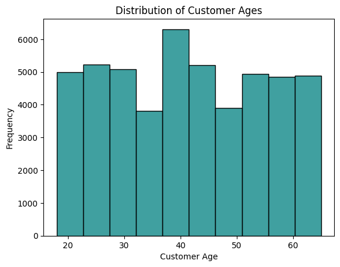
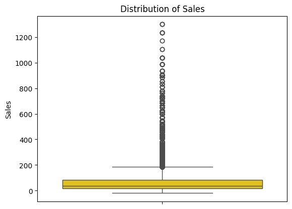
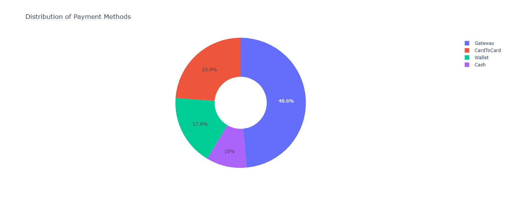
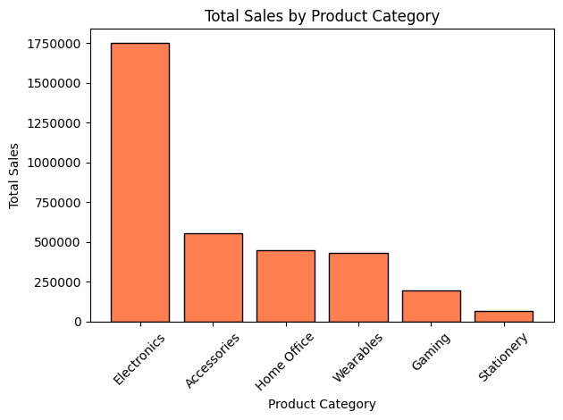
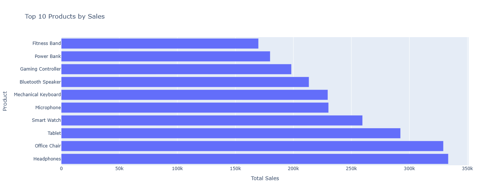
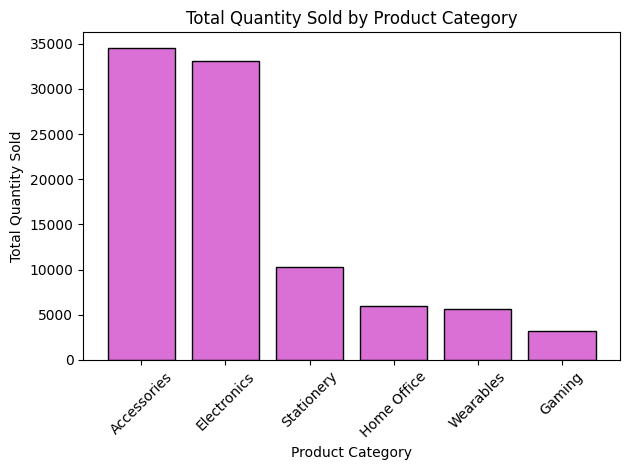
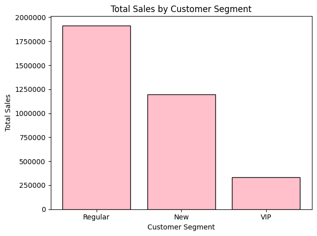
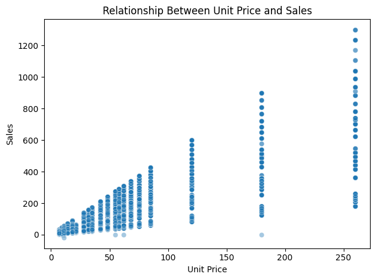
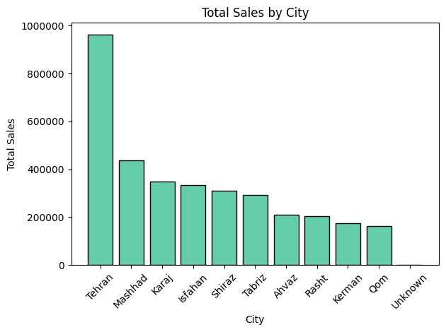

# E-Commerce Sales Analysis: Customer Behaviour, Product Performance and Sales Trends

## 1. Abstract

This project analyses e-commerce transaction data to understand customer purchasing patterns, product performance and sales trends. Using Python, the project covers data cleaning, exploratory data analysis (EDA), statistical analysis and data visualisation.

The original dataset contained 49,297 rows and 17 columns. After preprocessing, the final dataset contained 49,204 rows and 20 columns. The analysis identified Electronics as the leading product category by recorded sales, Tehran as the highest-performing city, and a strong positive correlation between unit price and sales.

## 2. Introduction

E-commerce transaction data can provide insights into customer behaviour, product performance and sales trends. This project explores these areas by analysing transaction records, comparing sales across categories and customer segments, and examining geographical and time-based patterns.

## 3. Problem Statement

The project addresses the need to transform raw e-commerce transaction data into meaningful insights. It examines differences in product performance, customer segments, geographical sales, payment methods and relationships between numerical variables to support a better understanding of recorded sales patterns.

## 4. Project Objectives

- Analyse overall recorded sales performance.
- Compare sales and quantities across products and categories.
- Examine customer age distribution and customer segments.
- Analyse geographical sales patterns across cities.
- Explore payment methods and order statuses.
- Identify monthly and annual sales trends.
- Investigate relationships between unit price, quantity, discount and sales.
- Present findings through statistical analysis and visualisations.

## 5. Dataset Description

### 5.1 Dataset Source

The dataset, *E-Commerce Sales Data Analysis & EDA*, was obtained from Kaggle.

**Source:** [E-Commerce Sales Data Analysis & EDA — Kaggle](https://www.kaggle.com/datasets/erfan4524/e-commerce-sales-data-analysis-and-eda)

### 5.2 Dataset Dimensions

| Stage | Rows | Columns |
|---|---:|---:|
| Original dataset | 49,297 | 17 |
| Final cleaned dataset | 49,204 | 20 |

The dataset contains transaction, customer, product, payment, order status and date information.

### 5.3 Description of Important Columns

| Column | Description |
|---|---|
| OrderID | Order or transaction identifier |
| CustomerID | Customer identifier |
| OrderDate | Order date |
| ProductName | Product name |
| Category | Product category |
| Quantity | Number of units recorded |
| UnitPrice | Unit price |
| Discount | Recorded discount value |
| Sales | Recorded sales value |
| PaymentMethod | Payment method |
| Status | Order status |
| CustomerSegment | Customer classification |
| Age | Customer age |
| City | Recorded city |
| SignupDate | Customer registration date |

`OrderValue` was removed during preprocessing because it contained the same values as `Sales`.

## 6. Tools and Technologies Used

| Tool / Technology | Purpose |
|---|---|
| Python | Data analysis and processing |
| Google Colab | Notebook environment |
| Pandas | Data cleaning and manipulation |
| NumPy | Numerical operations |
| Matplotlib | Static visualisations |
| Seaborn | Statistical visualisations |
| Plotly Express | Interactive charts |

## 7. Data Loading and Initial Inspection

### 7.1 Data Loading

The dataset was loaded into Google Colab using Pandas and the `pd.read_csv()` function. The data was stored in a DataFrame named `df`.

### 7.2 Initial Data Inspection

The following methods were used to inspect the dataset:

- `df.head()` and `df.tail()` — preview records.
- `df.info()` and `df.dtypes` — inspect structure and data types.
- `df.shape` — check dataset dimensions.
- `df.describe()` — review numerical statistics.
- `df.isnull().sum()` — identify missing values.
- `df.duplicated().sum()` — identify duplicate records.

### 7.3 Summary of Initial Inspection

The initial inspection established the dataset's dimensions, data types, numerical characteristics and data quality issues before preprocessing.

## 8. Data Cleaning and Preprocessing

Data cleaning was performed to improve data consistency and prepare the dataset for analysis.

### 8.1 Handling Missing Values

A total of 250 missing values were identified and treated.

| Column | Missing values | Treatment |
|---|---:|---|
| Age | 150 | Median imputation |
| Discount | 50 | Median imputation |
| PaymentMethod | 20 | Mode imputation |
| City | 30 | Replaced with `Unknown` |

The final missing-value check returned zero missing values.

### 8.2 Removing Duplicate Records

A total of 75 duplicate rows were removed using Pandas. A subsequent check found no remaining duplicate rows.

### 8.3 Standardising Categorical Values

Inconsistent labels, capitalisation and surrounding spaces were standardised in `PaymentMethod`, `CustomerSegment`, `Category` and `City`.

### 8.4 Correcting Data Types

`OrderDate` and `SignupDate` were converted from object to `datetime64[ns]` to support date-based analysis.

### 8.5 Identifying and Handling Invalid Transaction Values

Eighteen completed transactions with negative quantities were removed. One cancelled transaction with a negative quantity was retained because its validity could not be conclusively established.

### 8.6 Removing Redundant Columns

`OrderValue` was removed because its values were identical to `Sales`.

### 8.7 Identifying Potential Outliers Using the IQR Method

The Interquartile Range (IQR) method was used to identify potential outliers.

| Column | Potential outliers |
|---|---:|
| Sales | 3,879 |
| UnitPrice | 1,691 |
| Quantity | 4,901 |

Potential outliers were retained because unusual values do not necessarily indicate errors.

### 8.8 Creating Additional Features

Four derived features were created:

- `OrderYear`
- `OrderMonth`
- `OrderMonthName`
- `AgeGroup`

Customer age groups were defined as 18–25, 26–35, 36–45, 46–55 and 56–65.

### 8.9 Validation and Final Dataset

After cleaning, removing duplicates and creating derived features, the final dataset contained **49,204 rows and 20 columns**.

## 9. Exploratory Data Analysis (EDA)

EDA was conducted to examine sales performance, product demand, customer characteristics, geographical patterns, transaction behaviour and numerical relationships.

### 9.1 Overall Performance Analysis

| Metric | Result |
|---|---:|
| Total recorded sales | 3,445,750 |
| Transaction records | 49,204 |
| Unique order IDs | 49,204 |
| Unique customers | 9,820 |
| Total quantity recorded | 92,658 |

### 9.2 Product and Category Analysis

#### 9.2.1 Sales by Product Category

| Product category | Recorded sales |
|---|---:|
| Electronics | 1,751,491 |
| Accessories | 553,158 |
| Home Office | 446,065 |
| Wearables | 429,497 |
| Gaming | 198,302 |
| Stationery | 67,237 |

Electronics contributed approximately 50.8% of total recorded sales, making it the leading category by sales value.

#### 9.2.2 Top Products by Recorded Sales

| Rank | Product | Recorded sales |
|---:|---|---:|
| 1 | Headphones | 333,531 |
| 2 | Office Chair | 329,292 |
| 3 | Tablet | 292,344 |
| 4 | Smart Watch | 259,590 |
| 5 | Microphone | 230,309 |

Headphones recorded the highest sales value among the top ten products.

#### 9.2.3 Quantity Sold and Average Unit Price

Accessories recorded the highest quantity sold, followed by Electronics. Wearables and Home Office had the highest average unit prices, while Stationery had the lowest.

### 9.3 Customer Analysis

#### 9.3.1 Customer Age Distribution

The mean customer age was 41.28 years, and the median was 41 years. Ages ranged from 18 to 65.

#### 9.3.2 Sales by Customer Segment

| Customer segment | Recorded sales | Share |
|---|---:|---:|
| Regular | 1,915,222 | 55.6% |
| New | 1,196,503 | 34.7% |
| VIP | 334,025 | 9.7% |

Regular customers contributed the largest share of recorded sales.

### 9.4 Geographical Analysis

#### 9.4.1 Recorded Sales by City

| City | Recorded sales |
|---|---:|
| Tehran | 963,320 |
| Mashhad | 438,089 |
| Karaj | 350,030 |
| Isfahan | 334,459 |
| Shiraz | 310,926 |

Tehran recorded the highest sales value, representing approximately 28% of total recorded sales.

### 9.5 Payment Method and Order Status Analysis

#### 9.5.1 Payment Method Distribution

| Payment method | Records | Share |
|---|---:|---:|
| Gateway | 23,891 | 48.6% |
| CardToCard | 11,738 | 23.9% |
| Wallet | 8,655 | 17.6% |
| Cash | 4,920 | 10.0% |

Gateway was the most frequently recorded payment method.

#### 9.5.2 Order Status Distribution

| Order status | Records | Share |
|---|---:|---:|
| Completed | 45,258 | 92.0% |
| Cancelled | 2,438 | 5.0% |
| Returned | 1,508 | 3.1% |

Most transaction records were marked as Completed.

### 9.6 Time-Based Sales Analysis

#### 9.6.1 Annual Recorded Sales

| Year | Recorded sales |
|---|---:|
| 2024 | 1,460,427 |
| 2025 | 1,444,771 |
| 2026 (January–June) | 540,552 |

Recorded sales decreased by approximately 1.1% from 2024 to 2025. The 2026 total covers only six months.

#### 9.6.2 Monthly Sales Patterns

May 2025 recorded the highest monthly sales value at 130,625. February 2026 recorded the lowest at 75,132 among the months examined.

### 9.7 Quantity, Pricing and Discount Analysis

| Metric | Quantity | UnitPrice | Discount |
|---|---:|---:|---:|
| Mean | 1.88 | 40.29 | 7.48 |
| Median | 2.00 | 28.00 | 5.00 |
| Minimum | -2 | 7.00 | 0.00 |
| Maximum | 5 | 260.00 | 30.00 |

The dataset showed variation in quantity, unit prices and discount values. The currency and discount units were not confirmed.

#### 9.7.1 Relationship Between Unit Price and Sales

UnitPrice and Sales had a correlation coefficient of approximately 0.78, indicating a strong positive linear association.

### 9.8 Relationships Between Numerical Variables

| Variable pair | Correlation | Interpretation |
|---|---:|---|
| UnitPrice and Sales | 0.78 | Strong positive |
| Quantity and Sales | 0.42 | Moderate positive |
| Discount and Sales | -0.05 | Very weak negative |
| Age and Sales | Approximately 0.00 | Little or no linear relationship |

These correlations describe associations in the dataset and do not establish causation.

### 9.9 Summary of EDA Findings

The EDA identified differences in sales across product categories, products, customer segments and cities. It also revealed monthly sales fluctuations and positive relationships between UnitPrice, Quantity and Sales.

## 10. Data Visualisation

Twelve visualisations were created using Matplotlib, Seaborn and Plotly Express to examine distributions, comparisons, trends and relationships.

### 10.1 Univariate Analysis

#### 10.1.1 Distribution of Customer Ages

The histogram shows customer ages ranging from 18 to 65, with a concentration around ages 37–42.

#### 10.1.2 Distribution of Sales

The box plot highlights variation in recorded sales and potential outliers.

#### 10.1.3 Distribution of Payment Methods

Gateway was the most frequently recorded payment method, accounting for 48.6% of transaction records.

### 10.2 Bivariate Analysis

#### 10.2.1 Total Sales by Product Category

Electronics recorded the highest sales value among product categories.

#### 10.2.2 Top 10 Products by Sales

Headphones recorded the highest sales value among the ten products shown.

#### 10.2.3 Total Quantity Sold by Product Category

Accessories recorded the highest quantity sold, while Electronics led in recorded sales value.

#### 10.2.4 Total Sales by Customer Segment

Regular customers contributed the largest share of recorded sales.

#### 10.2.5 Relationship Between Unit Price and Sales

The scatter plot shows a positive association between unit price and recorded sales.

#### 10.2.6 Total Sales by City

Tehran recorded the highest sales value among the cities analysed.

#### 10.2.7 Order Status by Customer Segment

Completed transactions were the most common status across all three customer segments. This chart compares two categorical variables and is therefore bivariate.

### 10.3 Multivariate Analysis

#### 10.3.1 Monthly Sales Trends by Year

Monthly sales varied over time, with May 2025 recording the highest monthly value. The 2026 data covers January to June only.

#### 10.3.2 Correlation Heatmap of Numerical Variables

The heatmap highlights the strong positive correlation between UnitPrice and Sales (0.78) and the moderate positive correlation between Quantity and Sales (0.42).

## 11. Key Findings and Insights

- **Data quality:** Final dataset contained 49,204 rows and 20 columns.
- **Category performance:** Electronics contributed 50.8% of recorded sales.
- **Top product:** Headphones recorded sales of 333,531.
- **Customer segments:** Regular customers contributed 55.6% of recorded sales.
- **Geographical performance:** Tehran recorded the highest sales value.
- **Payment method:** Gateway accounted for 48.6% of records.
- **Order status:** Approximately 92% of records were marked Completed.
- **Sales trends:** May 2025 recorded the highest monthly sales value.
- **Numerical relationships:** UnitPrice and Sales had a correlation of 0.78.

## 12. Recommendations

- **Product performance:** Monitor Electronics and investigate opportunities in lower-contributing categories.
- **Inventory planning:** Consider both recorded sales and quantity sold when planning stock.
- **Customer analysis:** Examine repeat purchases, purchase frequency and average transaction value.
- **Geographical analysis:** Compare customer numbers and purchasing patterns across cities.
- **Payment methods:** Monitor payment reliability and transaction failures.
- **Cancellations and returns:** Investigate recurring reasons for cancelled and returned transactions.
- **Sales trends:** Compare equivalent periods before drawing conclusions about seasonality.
- **Further analysis:** Incorporate costs and profit margins to assess profitability.
- **Data quality:** Continue validating records and investigating unusual transaction values.

## 13. Conclusion

This project applied Python-based data cleaning, EDA, statistical analysis and visualisation to examine e-commerce transactions. The analysis identified patterns in product performance, customer segments, geographical sales, payment methods and monthly trends. The findings demonstrate how data analysis can support a clearer understanding of recorded sales and inform further investigation.

## 14. Limitations and Future Scope

### 14.1 Limitations

- Product costs, profit margins, marketing expenditure and customer feedback were unavailable.
- The 2026 data covers January to June only.
- Long-term customer retention could not be fully assessed.
- Correlation does not establish causation.
- One cancelled transaction with a negative quantity remained unresolved.

### 14.2 Future Scope

- Analyse product profitability using cost and margin data.
- Study repeat purchases and customer retention.
- Investigate cancellations and returns.
- Extend sales trend analysis with additional periods.
- Improve geographical analysis using customer counts.
- Explore sales forecasting and demand prediction.

